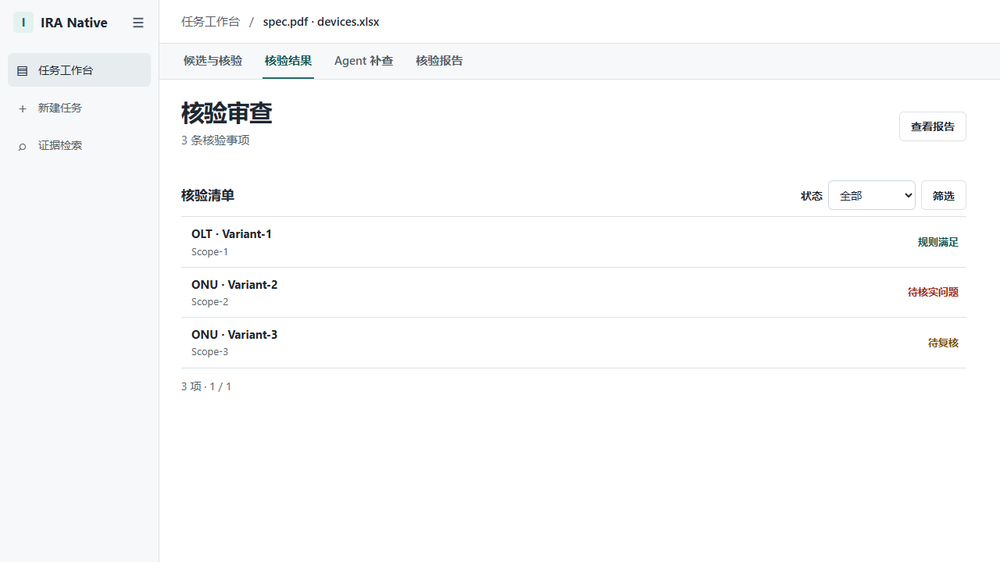

# IRA Native

**Evidence-Grounded Industrial Verification Workbench**
证据驱动的工业资料与技术参数核验工作台。

IRA Native runs locally. It links technical requirements and equipment declarations to source evidence, calculates conditional results with deterministic rules, and records human review before formal disposition.

## 工作台

登记技术规格 PDF、对应解析 JSON 和 CSV/XLSX 清单，选择资料、页和清单行。按设备或参数检索并回查 PDF 原文。核验支持明确属性的规范化、受支持的单位换算、计数口径及适用条件。多资料任务保留冲突和版本关系。逐项人工核验后可重算、查看失效历史，并导出报告。



## 从证据到结果

1. **Evidence-first**。证据保留来源、解析运行和物理定位，核验时可回查原页。
2. **Deterministic verification**。先核对主体、属性、单位、口径和适用条件，再计算条件化结果。依据不足时保留待复核。
3. **Human-in-the-loop**。字段、来源、实体和适用性独立核验。人工记录与输入快照绑定，源资料或记录变化后旧结果留在历史中。
4. **Bounded AI assistance**。单资料任务可选本机模型补查，默认关闭。模型建议不能代替人工确认，模型不可用时仍可继续确定性核验。

[系统架构](docs/architecture-current.md) · [使用指南](docs/user-guide.md) · [版本记录](CHANGELOG.md)

## 快速启动

需要 Python 3.12 和 uv。已验证环境为 Windows。源码工作树：

```powershell
uv sync --locked --python 3.12
$env:IRA_DB = Join-Path $PWD 'data/ira.sqlite'
$env:IRA_ENABLE_UPLOADS = '1'
uv run --locked ira doctor
uv run --locked ira serve --port 8000
```

打开 `http://127.0.0.1:8000`。已安装 wheel 的启动方式及合成演示生成命令见[使用指南](docs/user-guide.md)。

## 验证与边界

Windows 上已验证 rc2 的单资料连续复核、取消配对保护、重启恢复和报告一致性。截图与演示均为虚构资料，解析 JSON 为模拟格式。软件依赖已有解析产物，复杂表格和未确认的版本、工况或范围可能需要人工复核。真实工程验收、自动合规认证、跨块模型编译及非 Windows 环境兼容尚未验证。

功能基线 `d5eeb33` 的工程回归通过 287 项，跳过 5 项需本机模型的可选测试。上述验证使用公开合成输入。

## 许可

项目原创代码采用 [MIT 许可证](LICENSE)。PDF.js 及其附带资源的许可与声明见 [NOTICE](src/ira_native/interfaces/static/pdfjs/NOTICE.md)。
