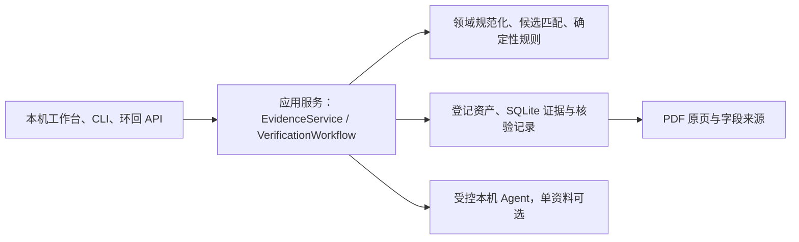

# 当前系统架构

应用服务登记资产和解析产物，并在明确授权的页与清单行内组织候选。领域规则接收来源可追溯的字段，在具备比较前提时进行条件化计算。正式处置依据当前来源、字段、实体绑定与适用性的人工记录；最近的配对快照驱动连续重算，旧快照与失效结果仍可追溯。

多资料任务保留各侧事实及版本冲突。修订替代需要明确关系、生效日期及人工确认，多资料原文预览按任务页范围返回。报告区分汇总和含原值的本机明细。

本机 Agent 只提供有边界的证据补查。受控候选接入是实验性 Python 宿主边界，限于授权来源可独立佐证的单块数值事实。没有默认自动补缺。

[多资料与信任规则](MULTI-SOURCE-VERIFICATION.md) · [领域输出契约](VERIFICATION-RESULT.md) · [早期架构设计与决策记录](ARCHITECTURE.md)
